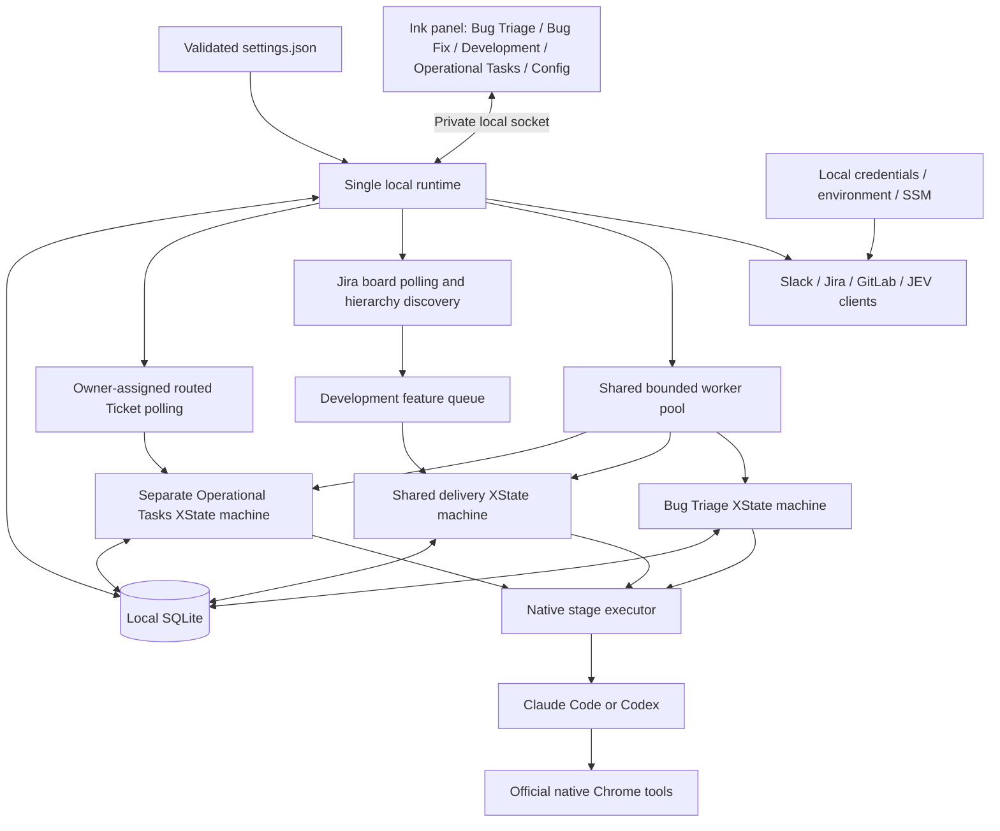
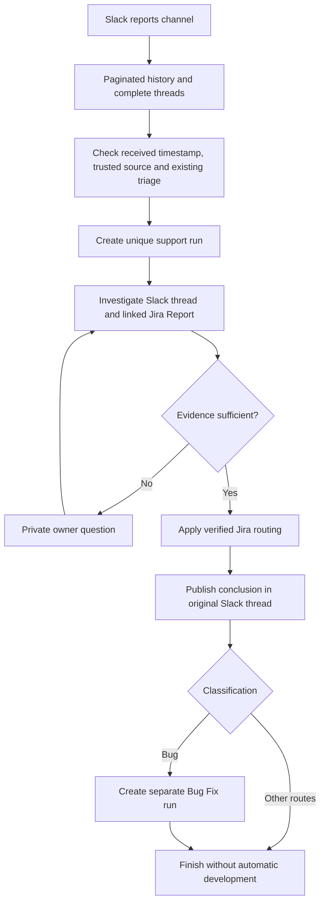
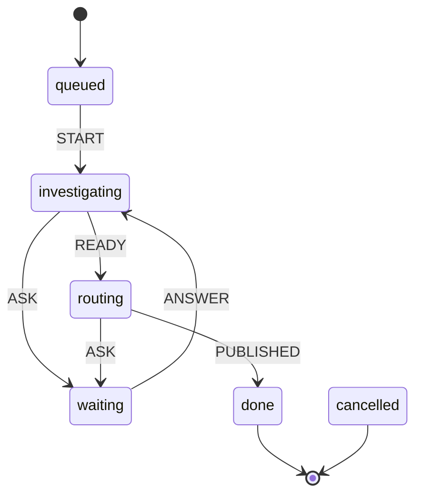
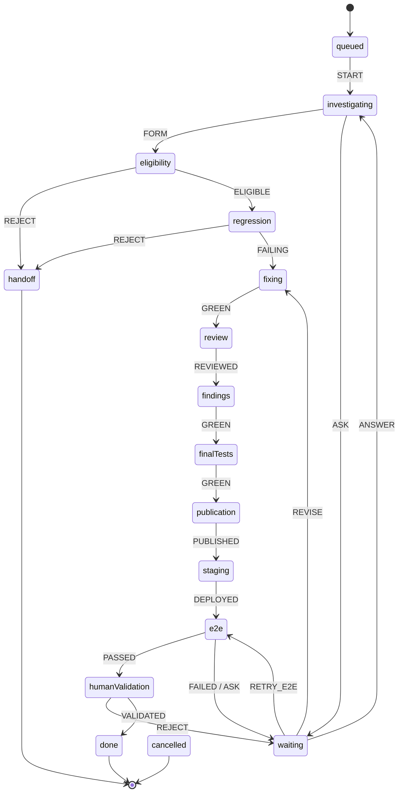
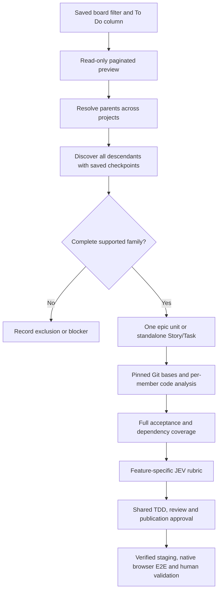
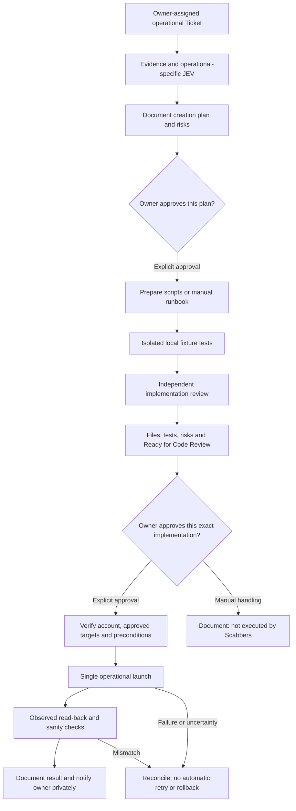

# Scabbers CLI

Scabbers is a local NOLA workbench for support triage and bounded development of **arccanet-backend**, **arccanet-frontend** and **arcca-pdv web**. It uses TypeScript, XState, SQLite and an Ink terminal interface. The **Bug Triage**, **Bug Fix**, **Development** and **Operational Tasks** tabs display separate queues; **Config** edits settings and connections directly in the terminal.

A single local runtime is owned by the open CLI panel. Closing the panel or its terminal stops processing; reopening resumes saved checkpoints. **Automation is off by default.** Enabling it permits the configured Slack/Jira workflow actions; code publication and final staging validation have separate human approval steps. Installing the CLI does not install an operating-system service.

## Install and configure

Use Node **24+**, Git, npm and the [Gitleaks CLI](https://github.com/gitleaks/gitleaks#installing). Install and authenticate the Claude Code or Codex CLI separately. Browser validation also requires the selected engine's official browser integration, a connected Chrome/Chromium profile and native site permissions.

```sh
npm ci
npm run build
npm install --global .
scabbers
```

For local development, use `npm run dev`; `npm start` runs the existing build.

1. Run `scabbers --configure` or follow the first-launch setup. Select an engine, owner identity, support schedule and repository paths. Configure the installed workflow skill paths and real staging endpoints.
2. Prepare and approve a personal `SOUL.md`. The included `$scabbers-soul` skill can generate it from selected conversations or notes; `scabbers --review-soul` reviews the exact proposed version. Setup only reads explicitly selected evidence files.
3. In **Config**, configure Slack, Jira and GitLab separately. Paste tokens through hidden terminal input, then select **Done → Save**. Check the connection results in the header and Config.
4. Review the activation screen with `e`, then select **Activate** using arrows and Enter when the configuration is ready.

The optional `$scabbers-configure` skill discovers IDs through connected integrations, proposes Brazilian defaults and generates an importable settings JSON with a discovery report. Unverified values remain explicit; generated configuration does not activate automation or grant external permissions.

### Settings and credentials

The editable configuration lives in `~/.config/scabbers/settings.json`, overridable with `SCABBERS_SETTINGS`. The file's `$schema` supports editor validation. Config exposes the same values through terminal menus; no external editor is required. See the [complete example](assets/config.example.json), [JSON schema](assets/settings.schema.json) and [configuration reference](docs/configuration.md).

This is an illustrative fragment, not a complete configuration:

```json
{
  "engine": "codex",
  "workers": 3,
  "remoteEnabled": false,
  "paths": ["/absolute/path/to/arcca"],
  "schedule": {
    "zone": "America/Sao_Paulo",
    "shifts": [
      { "day": "Monday", "start": "08:00", "end": "12:00" },
      { "day": "Friday", "start": "14:00", "end": "20:00" }
    ]
  },
  "browser": { "testOrigin": "https://staging.nolasistemas.com" }
}
```

Days are named `Monday` through `Sunday`; times use 24-hour `HH:mm`. Multiple intervals on the same day and overnight shifts are supported. Valid settings changes apply when active worker stages finish. Invalid settings stop new scheduling and display an error. Imports with `scabbers --config FILE` force automation off.

Personal `SOUL.md` lives beside the selected settings.json, normally `~/.config/scabbers/SOUL.md`. The runtime and profile skill resolve this location automatically; workspace `paths` no longer choose its destination. An explicit `soulFile` override resolves relative to the settings directory. Config displays the resolved absolute source path. Each new run reads the source and pins its approved snapshot; later edits affect future runs after review, not existing native conversations. Versioned snapshots and evidence remain in the private state directory.

Tokens entered in Config persist in a private local `credentials.json` with permissions `0600`; `settings.json` stores opaque `credentialKeys` references. This is plaintext storage protected by filesystem permissions. Selected local references take precedence over environment credentials; environment and configured AWS SSM references provide fallback when no local reference is selected. Replacing a token reloads the affected connections after active stages finish. Business integration tokens are not passed into engine subprocess environments; engines use their own authentication.

Model and effort are configurable per engine in `engines.codex` and `engines.claude`, through settings.json or **Config → Models, reasoning effort and quota fallback**. Native CLI/SDK calls receive explicit selected values. Profiles are pinned for running workflows. Optional `fallback` switches between configured engines only after a recognized usage-limit failure, preserving structured workflow context and separate native session IDs. Permissions, authentication and spend-cap failures remain blocked. See the [engine settings reference](docs/configuration.md#engine-models-effort-and-quota-fallback).

### Terminal controls

| Control                | Action                                                                |
| ---------------------- | --------------------------------------------------------------------- |
| `Tab`, `←`, `→`        | Switch Bug Triage, Bug Fix, Development, Operational Tasks and Config |
| `↑`, `↓`               | Select an execution, setting or menu option                           |
| `Enter`                | Open a setting or execution actions; confirm a menu choice            |
| `Esc`                  | Leave a menu without accepting its action                             |
| `Page Up`, `Page Down` | Scroll overflowing panel content                                      |
| `e`                    | Review automation activation                                          |
| `q`                    | Exit the panel and stop its runtime                                   |

```sh
scabbers --doctor
scabbers --status
scabbers --stop
scabbers --config /absolute/path/to/non-secret-config.json
```

A non-interactive launch prints status without starting a runtime. The footer keeps shortcuts at the bottom; the header separates **Automation active/off** from integration health. Green means authentication and configured access were verified; red means failed or unconfigured; yellow means checking. Successful health checks do not prove every workflow write permission.

**Bug Triage** reads support reports; **Bug Fix** receives normal bugs from that workflow. **Development** polls Jira for feature families and standalone Stories/Tasks. Existing `support` and `development` run kinds remain compatible; the new `feature` kind reuses the same delivery XState machine with feature-specific analysis and JEV criteria.

## Diagnostic logs

Scabbers writes readable daily logs to `~/.local/state/scabbers/logs/scabbers-YYYY-MM-DD.log` (or `SCABBERS_HOME/logs`). Each line identifies its UTC time and execution. Logs include stage transitions, visible engine messages, available tool activity, test output, decisions received and failures. They are operational diagnostics, not a complete native conversation transcript: hidden reasoning, raw prompts and full tool payloads are not collected. Claude's non-browser CLI path exposes its final result rather than intermediate tool events.

```sh
scabbers --logs
```

This displays the last 100 lines of the newest daily file without starting the runtime or requiring valid settings. Config shows the log directory, retention and any text-storage failure. Files use owner-only permissions and redact common credential patterns; diagnostics can still contain application data and should be reviewed before sharing.

Daily files and SQLite diagnostic rows expire after 30 days. Cleanup runs on startup and during use; it does not run while Scabbers is stopped. Run snapshots, decisions and profile evidence are preserved. If text-file writing fails, SQLite logging continues and Config reports the storage problem. Existing legacy `runtime.log` files are left untouched; the CLI no longer appends to them.

## Runtime architecture



The panel owns a single child runtime through a private IPC connection. Closing the panel (including abrupt owner death) shuts down the runtime and managed subprocesses. Workflow state and native sessions remain in SQLite for the next launch. A second panel cannot take ownership of an existing runtime. The pool advances persisted runs one stage at a time, up to `workers` concurrent stages. All four queues share that limit. Resource locks prevent conflicting work; native browser stages are serialized across the engines.

XState defines legal transitions for each workflow. The controller validates required evidence before sending an event, then saves the state and serialized machine snapshot in SQLite. Board/family discovery and per-member feature analysis checkpoints are saved too. Native engine session IDs are saved too: another stage resumes its conversation rather than silently replacing it. Bug Fix starts its own native conversation; its independent review uses a separate clean session.

### What SQLite preserves

State defaults to `~/.local/state/scabbers/`, overridable with `SCABBERS_HOME`. The database is `scabbers.db`; tokens remain in the separate credentials file.

| Stored data                                 | Purpose                                                               |
| ------------------------------------------- | --------------------------------------------------------------------- |
| Runs, stage data and XState snapshots       | Resume support and development after a restart                        |
| Native session IDs and pinned profiles      | Keep conversation identity and SOUL evidence consistent               |
| Slack watermarks and pagination checkpoints | Continue intake from the saved position                               |
| Decisions and authenticated answer receipts | Wait for and validate human decisions without duplicate processing    |
| Effect receipts and remote markers          | Reconcile retries before repeating Slack, Jira or publication actions |
| Resource locks and stage logs               | Prevent conflicting work and explain progress or blockers             |

A unique `(kind, source)` constraint prevents duplicate runs for the same input. Effect receipts are paired with remote reconciliation; they are not a blanket exactly-once guarantee for arbitrary external APIs. Errors preserve the checkpoint and request intervention. Pausing or cancelling interrupts an active stage; cancelling does not undo already completed external actions.

## Bug Triage: intake, triage and handoff



Bug Triage reads the configured reports channel, normally `#reports-support`. The known **Criar report** bot is an explicit intake exception; unrelated bots and Scabbers publications do not create feedback loops. A report is admitted according to its received timestamp inside the configured shifts. Eligible messages after the saved watermark can be recovered after downtime, even when the runtime resumes outside the shift. Initial setup establishes a watermark; it does not scan unlimited historical messages.

The investigation reads complete threads and verified Jira evidence. Objective routes include **Bug**, **Bug Crítico**, **Ticket**, **duplicate** and **cancel**. Existing identifiable triage is left alone. Duplicates require a verified open Bug; cancellation requires a valid evidenced reason and live Jira metadata. Product or missing-information handoffs keep the Report open. Ambiguous cases ask the configured owner privately.

After Jira routing and Slack publication, **only a normal Bug** creates an automatic Bug Fix run. Bug Crítico and other routes do not enter development through this handoff. The new run links the destination issue and source run, inherits the selected engine and pinned SOUL, and starts with pending technical scope. The support run finishes; it does not implement the correction itself. The Bug Fix run rereads the Jira issue and code instead of copying the entire support conversation.

The support machine's principal transitions are:



A `CANCEL` event is also available from active states. Implementation: [support processor](src/support/support-processor.ts), [intake](src/support/intake.ts), [XState definitions](src/workflows/machines.ts).

## Bug Fix: eligibility, TDD and staging

**JEV runs inside Bug Fix, after the handoff and technical investigation, before creation of the correction branch or code edits.** It evaluates the versioned eligibility form using both option orders. A non-eligible result is handed off; missing JEV access blocks the checkpoint. Being assigned a Bug is not development authorization.



The controller advances these stages only with the required evidence:

1. **Investigation and eligibility:** fetch each configured repository’s `origin` base branch and pin a detached analysis worktree before reading the Bug and actual code, establish repositories/products and a bounded file plan, then consult JEV. Unresolved decisions and restricted domains require human answers. Totem, SmartPOS/noah-smart-pos and mixed flows involving them are excluded from autonomous development.
2. **Isolated workspace and TDD:** prepare a task branch/worktree, verify a passing baseline, add only the regression test and demonstrate a failure caused by the defect. Implementation is forbidden without that evidence. Apply the bounded fix and require passing configured tests.
3. **Review and final tests:** run one independent review in a fresh native session, address its findings and rerun final tests. Preserve the review evidence instead of starting repeated independent reviews.
4. **Publication approval:** present a concrete diff and digest for an authenticated human decision. Approved publication pushes the task branch, serializes integration into `staging` and creates a draft MR targeting `master`. It does not merge `master` or deploy production.
5. **Staging and browser E2E:** verify the expected revision, successful CI/deployment and configured staging endpoint, then exercise observable acceptance criteria using native browser tools. A missing extension, login, permission or deployment remains a blocker.
6. **Human validation:** after automatic E2E passes, obtain explicit human confirmation. Then remove the MR's draft status and advance Jira to **Ready for Code Review**. A passing browser check alone does not finish delivery.

Before investigation, the controller fetches `origin/<baseBranch>` and pins its commit in a detached worktree. Each repository can set `baseBranch` (default `master`; set `main` where appropriate). The correction branch is created at that same revision only after JEV eligibility. The source checkout and local edits stay unchanged; a failed fetch blocks new preparation instead of using a cached ref. Retries reuse the pinned worktree without fetching a different base. Older in-flight worktrees remain intact. A browser-access retry returns to E2E; an explicit revision decision starts a new bounded fixing attempt with previous evidence preserved and review/publication approvals invalidated. A checkpoint error instead remains at its saved stage until retried. `CANCEL` is available from active states.

Jira images attached to the collected epic, children or report are available during read-only analysis. The controller downloads PNG, JPEG and WebP files through the authenticated Jira API; tokens and remote download access are never delegated to the model. For per-member analysis, ancestor images accompany the current child. Codex receives native image attachments, including on resumed turns; Claude is instructed to inspect the local files with its image-capable Read tool. The prompt identifies each image's card, attachment and content hash and treats its contents as untrusted evidence. An unreadable image must be reported as missing evidence, never as an observed requirement.

The private state directory contains a `jira-images/` cache (directory mode 0700, files 0600), outside the repository. Images are limited to 5 MiB each, 12 per analysis and 20 MiB total. Unsupported image formats, failed downloads or invalid content block the checkpoint rather than silently dropping evidence. PDF and other non-image attachments remain metadata only. These evidence files are separate from the 30-day diagnostic-log retention; they are not automatically deleted with logs. Adding or removing attachments changes the family scope digest. Existing completed analyses are preserved; restart/reset those test runs explicitly if they must incorporate newly attached evidence.

Implementation: [development processor](src/development/development-processor.ts), [workspace](src/development/workspace.ts), [publication](src/development/publication.ts), [evidence guards](src/workflows/evidence-guards.ts).

## Polling, events and integration credentials

The runtime calls the integrations directly with the configured credentials. Connected agent plugins help discover setup values; they are not the runtime's transport for Slack or Jira. Slack uses its bot token; Socket Mode additionally requires an app-level token. Jira uses its configured email and API token. GitLab and JEV use their own credentials.

| Operation                                | Normal interval or trigger     | Behavior                                                                                |
| ---------------------------------------- | ------------------------------ | --------------------------------------------------------------------------------------- |
| Runtime scheduler                        | Every second                   | Reload validated settings and advance eligible stages                                   |
| Slack report intake                      | Every 60 seconds               | Read paginated channel history since the saved watermark, then inspect threads          |
| Slack Socket Mode                        | Optional incoming events       | Bring the next intake sweep forward; process decision events                            |
| Private decision replies                 | Every 15 seconds               | Accept only the configured user's authenticated answers; retry polling later on failure |
| Pending-decision reminders               | Every 10 minutes               | Remind the owner while a decision remains pending                                       |
| Slack/Jira/GitLab health                 | Every 60 seconds               | Test authentication and configured access, including while automation is off            |
| Jira issue evidence and workflow updates | On demand at a task checkpoint | Read issue/comments/metadata or apply the required idempotent workflow action           |
| GitLab staging readiness                 | At staging and E2E checkpoints | Verify revision, CI and deployment for the published change                             |

**There is no periodic scan of all Jira cards.** The Slack report and linked Jira issue feed the current handoff. A healthy Jira connection does not by itself enqueue its backlog. Socket Mode is optional; paginated Slack polling continues as the supported baseline. Intake and initialization errors use bounded exponential backoff, so intervals can increase during failures. Operations and approvals wait when automation is off; connection health checks remain available.

## Development: Jira tasks and epic families

The controller uses the configured Jira token to resolve the saved board filter and actual To Do-column statuses, and always adds an assignee filter using `jira.accountId`. Only cards assigned to that configured owner can enter implementation scope. For **Visão Unificada Nola**, the known board is `28`; its current saved filter is `10594` and the column includes both To Do and Open. The LLM receives collected evidence, not the token, and does not perform polling. Discovery is independent of the support shift.



An Epic owns one implementation branch per affected repository for the selected owner-assigned subset of its family. Other assignees, unassigned siblings and product parents are read-only context. Its product status (such as Ready for Dev or Delivery) is context: it is not treated as active engineering work or transitioned by Scabbers. Engineering child cards form the change scope. A standalone Story/Task owns its own branches and includes its subtasks. Completed relatives are context, not new work. Unsupported/mixed active bug families, opt-outs, inaccessible members, cycles and concurrent work are excluded or blocked explicitly. Search can only reveal cards visible to the Jira account; explicit inaccessible references block that group, and hidden cards cannot be independently inferred.

SQLite persists discovery pages, family membership, semantic requirement fingerprints, analysis results and delivery scope. Sibling candidates deduplicate into one family. Member locks prevent overlapping Bug Fix/Development stages. Requirements, membership and assignees are rechecked at delivery boundaries and after approval waits; changed scope blocks the pinned attempt. Jira writes check assignment again. A later changed family can create a new delivery after the previous run is closed.

Configure **Config → Development intake** or `development` in settings.json. New installations default to disabled. Enabling it permits automatic feature intake for the configured board: the runtime first completes a read-only preview, then enqueues fully discovered, supported groups. Both this setting and global Automation must be on. Discovery progresses in bounded batches; temporary board failures back off. One inaccessible family is recorded without stopping unrelated groups.

```sh
scabbers --preview-development
scabbers --preview-development --refresh
```

These commands do not start the runtime or modify Jira. Repeat a partial preview to continue; `--refresh` starts a fresh one. The Development tab shows discovery progress and separate feature runs. Config also exposes the board, column, polling interval and optional workflow mappings. A `development.transitions` key has the format `PROJECT/Issue Type`, with verified `claim`, `documented` and `validated` target names. Mapped targets are checked against actual Jira transitions; unmapped types receive progress comments and retain their status. Engineering transitions are capped at To Do/Open, Analysis, Solution Analysis, In Progress, Docs & Tests and Ready for Code Review. Ready for QA, QA, Done and production transitions are outside this delivery scope. Epic product status is always preserved, even if a mapping exists. Completed/context cards receive no delivery updates.

Feature JEV uses the separate `jev-feature-family-1.0.0` rubric, both alternative orders and a provisional `0.89` threshold. Product answers refine the full plan before reevaluation. File budgets, provider/domain restrictions, failing acceptance checks, one independent review per attempt, concrete publication approval and human staging validation remain mandatory. No main/master merge or production deployment is automated. Browser-access retries return to E2E; a rejected delivery starts a new explicit revision attempt, preserving prior evidence and invalidating its review/publication approvals.

## Native browser validation

Both engines reuse the existing Chrome/Chromium profile without copying cookies or enabling remote debugging. Scabbers scopes E2E to the task's configured staging endpoints. The engine and extension govern site permissions; `browser.testOrigin` selects a diagnostic target, not an access grant.

Codex loads the installed first-party browser transport and documented user browser policy. Claude uses the official Agent SDK with the installed Claude CLI; browser-stage native Chrome tool requests are approved automatically, while unrelated host tool requests are denied. This does not write persistent site permissions or override native denials. Non-browser stages retain their restricted permissions.

**Config → Browser → Test saved browser settings (read-only)** records a connection diagnostic and retains the native session for retries. Real checks confirmed a staging login page through Codex and the staging home page through Claude. A further Claude check captured before/after screenshots and clicked **Comunicados** in the app menu, confirming the internal route. These observations validate browser transport, screenshots and navigation. They do not establish a complete report-to-fix-to-staging delivery or every application's authenticated behavior.

## Local checks and pre-commit hook

Prettier and Vitest are development dependencies. Husky installs the Git hooks during `npm install` / `npm ci`. Before each commit, the hook runs:

```sh
npm run secrets:check
npm run format:check
npm test
```

The formatting check covers all supported files across the working tree, including assets, JSON and documentation. Dependencies, generated build output, coverage and Husky internals are excluded. Gitleaks scans the staged diff with its default rules and redacts findings. A missing Gitleaks executable, detected secret, formatting error or test failure blocks the commit. The hook does not rewrite or stage files, so it preserves partial staging. Apply formatting explicitly, review the changes and stage them:

```sh
npm run format
npm run typecheck
npm test
npm run format:check
npm pack --dry-run
```

`npm test` builds first and runs the Vitest suite, including tests against the compiled entry point. The generated settings schema is formatted during the build too. Tests use private temporary state, local Git repositories and explicit integration doubles; they do not contact business systems. No CI/CD pipeline is installed by these local hooks.

## Further references

- [Tasks and planned work](tasks/README.md) — new tasks start in **To do**; use **In progress** and **Done** as work advances.
- [Configuration and credentials](docs/configuration.md)
- [Architecture](docs/architecture.md)
- [Verification evidence and remaining gaps](docs/verification.md)
- [External prerequisites and limits](docs/limits.md)

### Private decision replies

Reply directly in the owner’s private Slack thread; no decision ID or prefix is required. Scabbers matches the channel and thread, verifies the pinned owner, and accepts only messages sent after the current question. Older answers cannot answer a later question in the same thread. Legacy ID-prefixed replies remain supported. If multiple questions share a thread, an unqualified reply is not guessed.

When evidence supports concrete alternatives, the analysis proposes numbered choices, their consequences and an explained recommendation. A recommendation never supplies approval. Questions needing unknown facts can remain open. Scabbers adds numbered reactions to the question itself; select one, use an available button, send its number, or write a different answer in the thread. Only the owner’s reaction counts; bot reactions only display the choices. Multiple selected reactions discovered by polling remain unresolved. With Socket Mode, a valid owner reaction event selects that option immediately.

Slack requires `reactions:read` and `reactions:write` for reaction choices. If those calls fail, buttons and thread replies remain available. Reaction events use Socket Mode when connected; the existing private-decision poll also checks reactions and replies every fifteen seconds. Existing pending questions are not reposted or changed: their already sent owner replies can be recovered on the next poll after loading this version.

### Repository discovery from workspace roots

Set `paths` to the directory containing your NOLA checkouts. The runtime discovers `arcca-pdv`, `arccanet-frontend` and `arccanet-backend` in its immediate children, or accepts those repository directories directly. It checks the Git marker and rejects conflicting duplicate checkouts. It does not recursively crawl worktrees or add Totem/SmartPOS to the supported delivery scope. Discovery is refreshed when runtime configuration loads, without writing the expanded catalog back into your settings.

`repositories` is an optional metadata/override list. Existing explicit entries continue to work. Both support code investigation and development use pinned workspaces. Analysis needs the repository path and defaults to fetching `origin/master` into a pinned detached worktree, preserving the user checkout. Staging URLs and test commands can be omitted during analysis; a task cannot run its test or staging validation until that repository has the required verified metadata. Explicit overrides can select another base branch.

Feature analysis receives the current member’s complete description, the pinned analysis workspace paths and revisions, and complete sibling descriptions when the family fits the bounded context. Large families retain the member-by-member analysis pass and summaries, followed by synthesis; the model must not ask users to copy already collected sibling descriptions just because an intermediate step carries summaries. Fresh independent sessions receive the same relevant evidence.

### Generated plan validation and human questions

Feature coverage separates exact Jira-key dependencies from descriptive `technicalPrerequisites`. The controller checks both the schema and verified family/scope membership. An invalid generated plan is returned to the model for up to two automatic read-only repairs. The attempt count is saved across restarts; repair cannot invent cards, omit coverage, expand scope or supply human approvals. Repeated failure remains a maintainer blocker, rather than a product choice.

Product identity is normalized separately from eligibility: known display names such as “Nola Web”, “NOLA PDV web”, “Console web NOLA”, “API PDV” and “Serviço online-menu” map to the existing canonical web/repository identifiers. Case, whitespace, accents and separator differences do not become human decisions. Unknown names and any Totem/SmartPOS or mixed scope remain blocked; a web repository does not imply authorization for another product. Generated schemas request canonical names and require all affected products to be listed.

A complete validated feature plan is checkpointed before product scope checks. If that check fails, a retry reuses the saved plan after revalidation instead of repeating member analysis or synthesis. Product-name normalization never grants JEV eligibility, changes authenticated answers or bypasses publication/domain approvals.

Before asking an owner, the engine must consult explicit card instructions, recorded answers, pinned code, tests and available relevant logs. Missing evidence alone is not proof of missing or incorrect behavior. Questions should include a justified recommendation and its consequences; if implementation choices lack evidence, recommend gathering the missing evidence rather than inventing a product rule. Routine reversible technical choices within approved scope follow existing project conventions and record their rationale. Consequential product ambiguities, missing essential evidence and explicit approval gates still require an owner response. Personal preferences can refine this behavior through a reviewed SOUL proposal; preferences do not grant permissions.

### Read-only production diagnostics

An owner can enable `aws.readOnlyLogs` in settings.json, using the existing `aws.profile` and `aws.region` (default region `us-east-1`). Analysis stages then expose a dedicated MCP tool to Codex and Claude for CloudWatch `describe-log-groups` and `filter-log-events`. This replaces the blanket production-read prohibition without enabling production writes or general shell networking. The tool accepts only Lambda log groups, explicit incident windows of at most 24 hours, filtered event reads and pagination tokens. Each stage is limited to 20 queries; masked CloudWatch data is never unmasked. Credentials remain in the local AWS credential chain and are not placed in prompts. Output is bounded and credential-redacted; incomplete pages and inaccessible data are reported honestly.

Support investigation also reads up to three explicit source-thread links from the report, without recursively crawling Slack. Each source snapshot retains message and collection timestamps: later replies are current evidence, never retroactive facts about the initial analysis. The Scabbers bot must have channel access; the owner's connected Slack plugin can have different access. An inaccessible source is recorded as a collection limitation, not proof that evidence is missing. Previously collected, explicitly selected evidence can accompany a manual reassessment with its provenance.

### Context in private Slack messages

Initial follow-ups, decisions, reminders and checkpoint blockers identify the workflow as **Suporte · Bug Triage**, **Suporte · Bug Fix** or **Feature · Development**, with the verified card title/link and the stage. Decisions explain the known context, concrete problem, reason for asking and available choices. Recommendations show their rationale when supplied by the analysis. Technical failures are labeled as execution blockers; retry means trying after the cause is fixed, not authorizing a product change.

Context is snapshotted per decision/version in SQLite, so reminders retain the original facts across restarts. Existing questions are not reposted or silently rewritten; legacy reminders use only verified saved metadata. Numbered reactions, buttons and free thread replies keep their existing owner, channel and version checks. Sensitive text is redacted, untrusted text escaped and Slack element limits preserved.

Individual family-member analyses also receive their exact output schema: `approach` is a plain-text explanation. Object/array/type or wrong-card responses get up to two automatic read-only repairs per member, with attempts persisted across restarts. Existing sibling analyses, authenticated answers, native sessions and pinned revisions remain intact. This validation runs before the separately guarded final-plan validation.

## Operational Tasks: review a plan, then review its implementation

Operational **Tickets** created by Bug Triage are separate from Bug Fix and feature delivery. Enable **Config → Operational Tasks** or set `operations.enabled: true` (default `false`); `operations.pollSeconds` defaults to 60. Global Automation must also be enabled. The intake checks the configured Jira project, exact owner, Ticket type, To Do category, Scabbers routing marker and `no-auto` opt-out. It rechecks ownership and requirements before every stage. Existing started/completed operation markers prevent re-execution after a local database reset.



The first approval authorizes **creation and local tests only**. The second binds the exact plan, source requirements, complete artifact contents, passing tests and independent review. Generic agreement, Resume, an old approval or approval of the plan alone never authorizes an operation. Changes invalidate the corresponding approval. Unit scripts run under Linux `bubblewrap` with no network, host HOME, state database or credentials; missing sandbox support blocks the test. Files, outputs and receipts remain in the private state directory under `operations/<run>/<digest>` and SQLite; daily activity logs use the existing retention policy. Operational artifacts and approvals are not removed by the 30-day log cleanup.

The initial executable path supports local scripts and AWS targets with an explicit account/profile/region; unsupported systems or unknown essential write parameters produce a manual runbook. Remote scripts require account verification and use credential references, never embedded secrets. Read-only log access remains separately controlled by `aws.readOnlyLogs`. Scripts include preflight, mutation, verification and fixture tests; independent review must confirm preflight and verification are read-only. This review is evidence, not a guarantee against arbitrary script defects. No live production operation was used to validate this feature.

The JEV rubric is separate (`jev-operational-plan-1.0.0`, provisional threshold 0.89); it evaluates bounded operational preparation, not proof of a software bug. A non-candidate can still be documented but receives no automatic execution option. Jira receives the complete files and review evidence before the second approval, progressing only through available engineering transitions to **Ready for Code Review**. If no permitted path exists, the panel records a notice rather than moving to QA/Done. Being ready for review never means an operation ran. After an uncertain launch, inspect actual state before an explicitly reapproved plan; there is no automatic rollback or repeated mutation.

For a manual first test, open `scabbers`, switch to **Operational Tasks**, review the plan in Jira and answer its private Slack decision. Review generated files and local test evidence before considering the second approval. Closing the CLI stops processing and preserves checkpoints. This queue shares the existing global worker limit; operations targeting the same AWS account are serialized locally.
