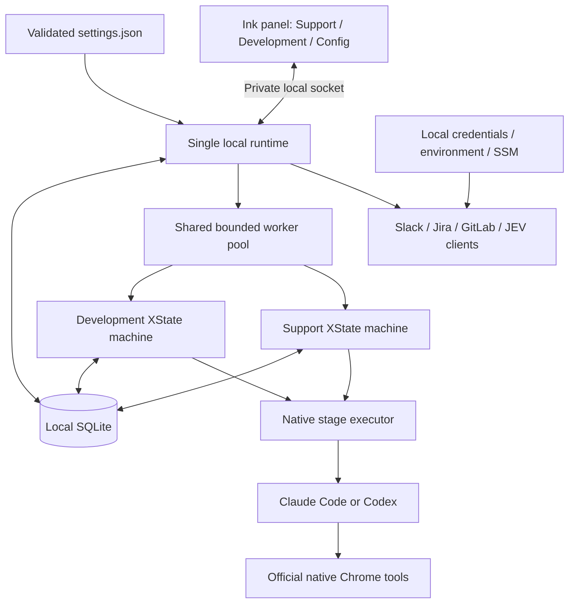
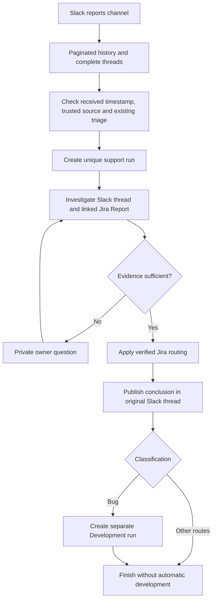
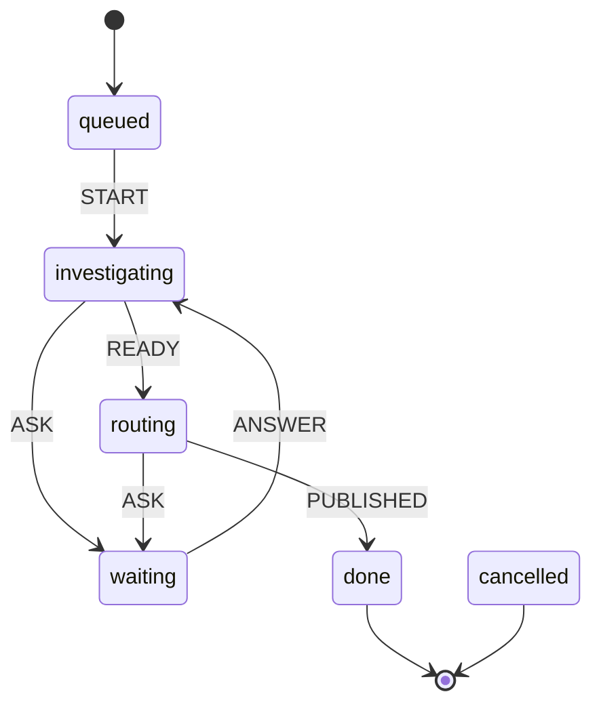
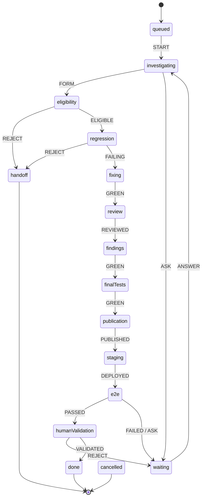

# Scabbers CLI

Scabbers is a local NOLA workbench for support triage and bounded development of **arccanet-backend**, **arccanet-frontend** and **arcca-pdv web**. It uses TypeScript, XState, SQLite and an Ink terminal interface. The **Support** and **Development** tabs display separate workflows; **Config** edits settings and connections directly in the terminal.

A single background runtime keeps working when you close the panel. **Automation is off by default.** Enabling it permits the configured Slack/Jira workflow actions; code publication and final staging validation have separate human approval steps. Installing the CLI does not install an operating-system service.

## Install and configure

Use Node **24+**, Git, npm and the [Gitleaks CLI](https://github.com/gitleaks/gitleaks#installing). Install and authenticate the Claude Code or Codex CLI separately. Browser validation also requires the selected engine's official browser integration, a connected Chrome/Chromium profile and native site permissions.

```sh
npm ci
npm run build
npm install --global .
scabbers
```

For local development, use `npm run dev`; `npm start` runs the existing build.

1. Run `scabbers --configure` or follow the first-launch setup. Select an engine, owner identity, support schedule and repository paths. Configure the installed workflow skill paths and real staging endpoints.
2. Prepare and approve a personal `SOUL.md`. The included `$scabbers-soul` skill can generate it from selected conversations or notes; `scabbers --review-soul` reviews the exact proposed version. Setup only reads explicitly selected evidence files.
3. In **Config**, configure Slack, Jira and GitLab separately. Paste tokens through hidden terminal input, then select **Done → Save**. Check the connection results in the header and Config.
4. Review the activation screen with `e`, then select **Activate** using arrows and Enter when the configuration is ready.

The optional `$scabbers-configure` skill discovers IDs through connected integrations, proposes Brazilian defaults and generates an importable settings JSON with a discovery report. Unverified values remain explicit; generated configuration does not activate automation or grant external permissions.

### Settings and credentials

The editable configuration lives in `~/.config/scabbers/settings.json`, overridable with `SCABBERS_SETTINGS`. The file's `$schema` supports editor validation. Config exposes the same values through terminal menus; no external editor is required. See the [complete example](assets/config.example.json), [JSON schema](assets/settings.schema.json) and [configuration reference](docs/configuration.md).

This is an illustrative fragment, not a complete configuration:

```json
{
  "engine": "codex",
  "workers": 3,
  "remoteEnabled": false,
  "paths": ["/absolute/path/to/arcca"],
  "schedule": {
    "zone": "America/Sao_Paulo",
    "shifts": [
      { "day": "Monday", "start": "08:00", "end": "12:00" },
      { "day": "Friday", "start": "14:00", "end": "20:00" }
    ]
  },
  "browser": { "testOrigin": "https://staging.nolasistemas.com" }
}
```

Days are named `Monday` through `Sunday`; times use 24-hour `HH:mm`. Multiple intervals on the same day and overnight shifts are supported. Valid settings changes apply when active worker stages finish. Invalid settings stop new scheduling and display an error. Imports with `scabbers --config FILE` force automation off.

Personal `SOUL.md` lives beside the selected settings.json, normally `~/.config/scabbers/SOUL.md`. The runtime and profile skill resolve this location automatically; workspace `paths` no longer choose its destination. An explicit `soulFile` override resolves relative to the settings directory. Config displays the resolved absolute source path. Each new run reads the source and pins its approved snapshot; later edits affect future runs after review, not existing native conversations. Versioned snapshots and evidence remain in the private state directory.

Tokens entered in Config persist in a private local `credentials.json` with permissions `0600`; `settings.json` stores opaque `credentialKeys` references. This is plaintext storage protected by filesystem permissions. Selected local references take precedence over environment credentials; environment and configured AWS SSM references provide fallback when no local reference is selected. Replacing a token reloads the affected connections after active stages finish. Business integration tokens are not passed into engine subprocess environments; engines use their own authentication.

### Terminal controls

| Control                | Action                                                     |
| ---------------------- | ---------------------------------------------------------- |
| `Tab`, `←`, `→`        | Switch Support, Development and Config                     |
| `↑`, `↓`               | Select an execution, setting or menu option                |
| `Enter`                | Open a setting or execution actions; confirm a menu choice |
| `Esc`                  | Leave a menu without accepting its action                  |
| `Page Up`, `Page Down` | Scroll overflowing panel content                           |
| `e`                    | Review automation activation                               |
| `q`                    | Detach the panel; runtime continues                        |

```sh
scabbers --doctor
scabbers --status
scabbers --stop
scabbers --config /absolute/path/to/non-secret-config.json
```

A non-interactive launch prints status. The footer keeps shortcuts at the bottom; the header separates **Automation active/off** from integration health. Green means authentication and configured access were verified; red means failed or unconfigured; yellow means checking. Successful health checks do not prove every workflow write permission.

## Runtime architecture



The panel observes and controls the runtime; it does not own the job lifecycle. Closing and reopening it does not create another runtime. The pool advances persisted runs one stage at a time, up to `workers` concurrent stages. Support and Development share that limit. Resource locks prevent conflicting work; native browser stages are serialized across the engines.

XState defines legal transitions for each workflow. The controller validates required evidence before sending an event, then saves the state and serialized machine snapshot in SQLite. Native engine session IDs are saved too: another stage resumes its conversation rather than silently replacing it. Development starts its own native conversation; its independent review uses a separate clean session.

### What SQLite preserves

State defaults to `~/.local/state/scabbers/`, overridable with `SCABBERS_HOME`. The database is `scabbers.db`; tokens remain in the separate credentials file.

| Stored data                                 | Purpose                                                               |
| ------------------------------------------- | --------------------------------------------------------------------- |
| Runs, stage data and XState snapshots       | Resume support and development after a restart                        |
| Native session IDs and pinned profiles      | Keep conversation identity and SOUL evidence consistent               |
| Slack watermarks and pagination checkpoints | Continue intake from the saved position                               |
| Decisions and authenticated answer receipts | Wait for and validate human decisions without duplicate processing    |
| Effect receipts and remote markers          | Reconcile retries before repeating Slack, Jira or publication actions |
| Resource locks and stage logs               | Prevent conflicting work and explain progress or blockers             |

A unique `(kind, source)` constraint prevents duplicate runs for the same input. Effect receipts are paired with remote reconciliation; they are not a blanket exactly-once guarantee for arbitrary external APIs. Errors preserve the checkpoint and request intervention. Pausing or cancelling interrupts an active stage; cancelling does not undo already completed external actions.

## Support: intake, triage and handoff



Support reads the configured reports channel, normally `#reports-support`. The known **Criar report** bot is an explicit intake exception; unrelated bots and Scabbers publications do not create feedback loops. A report is admitted according to its received timestamp inside the configured shifts. Eligible messages after the saved watermark can be recovered after downtime, even when the runtime resumes outside the shift. Initial setup establishes a watermark; it does not scan unlimited historical messages.

The investigation reads complete threads and verified Jira evidence. Objective routes include **Bug**, **Bug Crítico**, **Ticket**, **duplicate** and **cancel**. Existing identifiable triage is left alone. Duplicates require a verified open Bug; cancellation requires a valid evidenced reason and live Jira metadata. Product or missing-information handoffs keep the Report open. Ambiguous cases ask the configured owner privately.

After Jira routing and Slack publication, **only a normal Bug** creates an automatic Development run. Bug Crítico and other routes do not enter development through this handoff. The new run links the destination issue and source run, inherits the selected engine and pinned SOUL, and starts with pending technical scope. The support run finishes; it does not implement the correction itself. The Development run rereads the Jira issue and code instead of copying the entire support conversation.

The support machine's principal transitions are:



A `CANCEL` event is also available from active states. Implementation: [support processor](src/support/support-processor.ts), [intake](src/support/intake.ts), [XState definitions](src/workflows/machines.ts).

## Development: eligibility, TDD and staging

**JEV runs inside Development, after the handoff and technical investigation, before creation of the correction branch or code edits.** It evaluates the versioned eligibility form using both option orders. A non-eligible result is handed off; missing JEV access blocks the checkpoint. Being assigned a Bug is not development authorization.



The controller advances these stages only with the required evidence:

1. **Investigation and eligibility:** fetch each configured repository’s `origin` base branch and pin a detached analysis worktree before reading the Bug and actual code, establish repositories/products and a bounded file plan, then consult JEV. Unresolved decisions and restricted domains require human answers. Totem, SmartPOS/noah-smart-pos and mixed flows involving them are excluded from autonomous development.
2. **Isolated workspace and TDD:** prepare a task branch/worktree, verify a passing baseline, add only the regression test and demonstrate a failure caused by the defect. Implementation is forbidden without that evidence. Apply the bounded fix and require passing configured tests.
3. **Review and final tests:** run one independent review in a fresh native session, address its findings and rerun final tests. Preserve the review evidence instead of starting repeated independent reviews.
4. **Publication approval:** present a concrete diff and digest for an authenticated human decision. Approved publication pushes the task branch, serializes integration into `staging` and creates a draft MR targeting `master`. It does not merge `master` or deploy production.
5. **Staging and browser E2E:** verify the expected revision, successful CI/deployment and configured staging endpoint, then exercise observable acceptance criteria using native browser tools. A missing extension, login, permission or deployment remains a blocker.
6. **Human validation:** after automatic E2E passes, obtain explicit human confirmation. Then remove the MR's draft status and advance Jira to **Ready for Code Review**. A passing browser check alone does not finish delivery.

Before investigation, the controller fetches `origin/<baseBranch>` and pins its commit in a detached worktree. Each repository can set `baseBranch` (default `master`; set `main` where appropriate). The correction branch is created at that same revision only after JEV eligibility. The source checkout and local edits stay unchanged; a failed fetch blocks new preparation instead of using a cached ref. Retries reuse the pinned worktree without fetching a different base. Older in-flight worktrees remain intact. A failed E2E or rejected validation enters `waiting`; answering currently returns the machine to investigation. A checkpoint error instead remains at its saved stage until retried. `CANCEL` is available from active states.

Implementation: [development processor](src/development/development-processor.ts), [workspace](src/development/workspace.ts), [publication](src/development/publication.ts), [evidence guards](src/workflows/evidence-guards.ts).

## Polling, events and integration credentials

The runtime calls the integrations directly with the configured credentials. Connected agent plugins help discover setup values; they are not the runtime's transport for Slack or Jira. Slack uses its bot token; Socket Mode additionally requires an app-level token. Jira uses its configured email and API token. GitLab and JEV use their own credentials.

| Operation                                | Normal interval or trigger     | Behavior                                                                                |
| ---------------------------------------- | ------------------------------ | --------------------------------------------------------------------------------------- |
| Runtime scheduler                        | Every second                   | Reload validated settings and advance eligible stages                                   |
| Slack report intake                      | Every 60 seconds               | Read paginated channel history since the saved watermark, then inspect threads          |
| Slack Socket Mode                        | Optional incoming events       | Bring the next intake sweep forward; process decision events                            |
| Private decision replies                 | Every 15 seconds               | Accept only the configured user's authenticated answers; retry polling later on failure |
| Pending-decision reminders               | Every 10 minutes               | Remind the owner while a decision remains pending                                       |
| Slack/Jira/GitLab health                 | Every 60 seconds               | Test authentication and configured access, including while automation is off            |
| Jira issue evidence and workflow updates | On demand at a task checkpoint | Read issue/comments/metadata or apply the required idempotent workflow action           |
| GitLab staging readiness                 | At staging and E2E checkpoints | Verify revision, CI and deployment for the published change                             |

**There is no periodic scan of all Jira cards.** The Slack report and linked Jira issue feed the current handoff. A healthy Jira connection does not by itself enqueue its backlog. Socket Mode is optional; paginated Slack polling continues as the supported baseline. Intake and initialization errors use bounded exponential backoff, so intervals can increase during failures. Operations and approvals wait when automation is off; connection health checks remain available.

## Native browser validation

Both engines reuse the existing Chrome/Chromium profile without copying cookies or enabling remote debugging. Scabbers scopes E2E to the task's configured staging endpoints. The engine and extension govern site permissions; `browser.testOrigin` selects a diagnostic target, not an access grant.

Codex loads the installed first-party browser transport and documented user browser policy. Claude uses the official Agent SDK with the installed Claude CLI; browser-stage native Chrome tool requests are approved automatically, while unrelated host tool requests are denied. This does not write persistent site permissions or override native denials. Non-browser stages retain their restricted permissions.

**Config → Browser → Test saved browser settings (read-only)** records a connection diagnostic and retains the native session for retries. Real checks confirmed a staging login page through Codex and the staging home page through Claude. A further Claude check captured before/after screenshots and clicked **Comunicados** in the app menu, confirming the internal route. These observations validate browser transport, screenshots and navigation. They do not establish a complete report-to-fix-to-staging delivery or every application's authenticated behavior.

## Local checks and pre-commit hook

Prettier and Vitest are development dependencies. Husky installs the Git hooks during `npm install` / `npm ci`. Before each commit, the hook runs:

```sh
npm run secrets:check
npm run format:check
npm test
```

The formatting check covers all supported files across the working tree, including assets, JSON and documentation. Dependencies, generated build output, coverage and Husky internals are excluded. Gitleaks scans the staged diff with its default rules and redacts findings. A missing Gitleaks executable, detected secret, formatting error or test failure blocks the commit. The hook does not rewrite or stage files, so it preserves partial staging. Apply formatting explicitly, review the changes and stage them:

```sh
npm run format
npm run typecheck
npm test
npm run format:check
npm pack --dry-run
```

`npm test` builds first and runs the Vitest suite, including tests against the compiled entry point. The generated settings schema is formatted during the build too. Tests use private temporary state, local Git repositories and explicit integration doubles; they do not contact business systems. No CI/CD pipeline is installed by these local hooks.

## Further references

- [Tasks and planned work](tasks/README.md) — new tasks start in **To do**; use **In progress** and **Done** as work advances.
- [Configuration and credentials](docs/configuration.md)
- [Architecture](docs/architecture.md)
- [Verification evidence and remaining gaps](docs/verification.md)
- [External prerequisites and limits](docs/limits.md)
