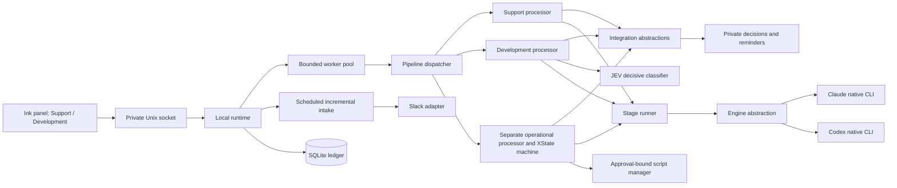

# Architecture

The validated `settings.json` is the editable configuration source; SQLite stores runtime state. The runtime reloads settings at idle stage boundaries and rejects invalid edits without falling back to stale configuration.

The composition root is `src/runtime/daemon.ts`. `src/cli.tsx` starts or reconnects to that runtime and renders `src/tui/app.tsx`. The runtime uses a private Unix socket and an exclusive PID file. A second panel connects to the same worker pool. This release targets a local Unix/Linux environment; it does not install systemd units or shell aliases.

## Boundaries

- Engine adapters declare capabilities and execute structured stages. The workflow has no scattered Claude/Codex conditionals. Claude editing uses documented absolute Edit rules, while the controller supplies the actual diff to a fresh review session without requiring shell access. A future Cursor adapter implements the same contract and declares its actual browser/session capabilities.
- `StageExecutor` combines the pinned profile, installed skill, controller instruction and task evidence. Structured results are validated with Zod. Task content cannot directly send workflow events or broaden permission.
- Support and development have separate XState machines. Evidence guards additionally reject eligibility, TDD, review, deployment and human-validation transitions without persisted prerequisites.
- Messaging, issue tracking, eligibility judgment and stage execution are interfaces in `abstractions/interface`. Integration adapters remain independent of engines.
- SQLite is the operational ledger. Transactions/unique constraints reserve sources, effects, decisions and resources. Actor snapshots are restored explicitly; arbitrary old snapshot formats are not silently migrated.
- `Effects` reserves a durable key, reconciles existing remote markers and records results. An uncertain prior attempt with no reconciled result blocks instead of repeating a potentially successful write. Distributed exactly-once transactions across Slack/Jira/GitLab are not claimed.
- `Workspace` enforces web product scope before preparation/edits, fetches the configured remote base into detached analysis worktrees, pins the revisions, then creates task branches after eligibility and checks the approved file plan, paths and symlinks. The implementer cannot merge/push through Claude's edit tools; those are controller-owned publication operations. Codex uses a workspace-write sandbox with network disabled and a minimal environment.
- Tests run as trusted configured argv. The controller checks an initially passing baseline, actual failing regression exit, attributed defect assertion, test-only initial changes, green implementation/finding checks and final unchanged content digest.
- Independent review uses one fresh native conversation. The implementer's session continues separately. A review launch is persisted before invocation; an uncertain review never silently becomes a second independent review.
- SOUL versions have immutable content/evidence, a manifest and parent revision. Markdown guides judgment; explicit controller/config rules grant permissions.

## Recovery

A crash preserves stage, native conversation ID, evidence, approvals, review count, pending decisions and external receipts. The runtime discards stale local resource reservations only after obtaining the singleton runtime lock. An observed engine process still alive prevents another launch for that run. If a launch has no confirmed session ID, recovery requires inspection instead of manufacturing a replacement conversation.

Pause/cancel cannot be undone by a stale worker save. Excess runs remain queued. A pending human decision excludes only its own run from scheduling; reminder polling has no LLM calls. The runtime advances worker stages independently of history-poll backoff. A persisted blocker can notify the private thread and resume from the same checkpoint after an authenticated retry response.

Publication records committed heads, staging revisions and MR receipts per repository. A lost MR response is reconciled by marker. Partial multi-repository deliveries preserve completed checkpoints and cannot be treated as an atomic success.

## Technical sources

The implementation follows [XState persisted snapshots](https://stately.ai/docs/persistence), the supported installed native CLI help, [Claude file permission rules](https://code.claude.com/docs/en/permissions), [native Chrome prerequisites](https://code.claude.com/docs/en/chrome), [Jira Cloud issue metadata and transitions](https://developer.atlassian.com/cloud/jira/platform/rest/v3/api-group-issues/), and [Slack conversations.replies pagination](https://docs.slack.dev/reference/methods/conversations.replies/). XState 5 is pinned; the alpha XState 6 persistence format is not used. The versioned JEV form and systemone request/response contract were ported from the preserved NOLA implementation, not guessed from an LLM classification API.

## Operational preparation and execution

`src/operations` owns its machine, processor, plan/implementation schemas, approval proof, documentation, intake and stage classes. Contracts live in `types` and `abstractions/interface`; stage classes receive dependencies through `OperationalContext`. The pipeline dispatches the operational kind before generic delivery recovery, preserving its independent approval and reconciliation semantics.

The controller builds a creation plan from verified Ticket evidence and pinned repositories, consults the dedicated operational JEV rubric and asks the authenticated owner for creation approval. It writes versioned files only afterward, runs unit fixtures in an isolated Linux bubblewrap process and requests an independent native review. Files and results are documented before asking for exact implementation approval. The script manager verifies approval receipts, unchanged bytes, current source scope, account identity and all approved preconditions before the single launch. Read-back checks must cover every success criterion. A started receipt is durable before invocation; interrupted launches enter reconciliation, never an automatic retry. Unsupported targets remain documentation/manual handling. Refer to the README for activation and supported script boundaries.
